<picture>
  <source media="(prefers-color-scheme: dark)" srcset="./dark_mode.svg">
  
</picture>

  <picture>
    <source media="(prefers-color-scheme: dark)" srcset="https://skillicons.dev/icons?i=ts,js,nextjs,react,tailwind,supabase,postgres,vercel,githubactions&theme=dark">
    
  </picture>

